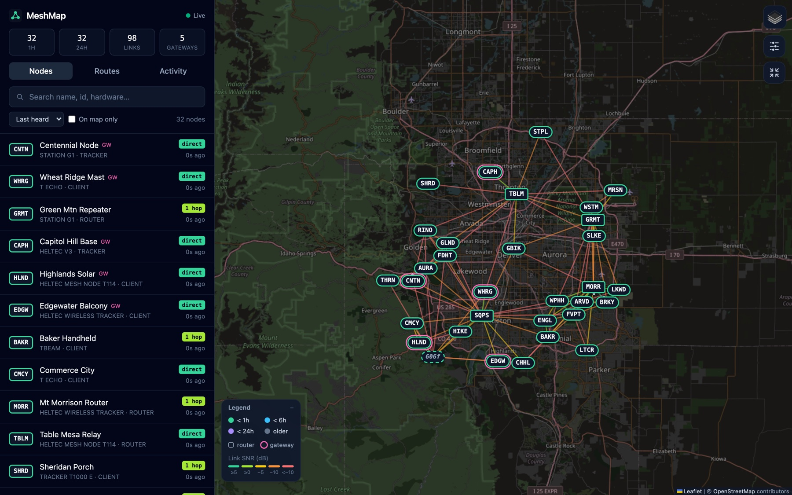
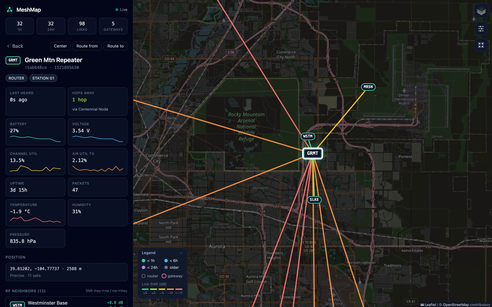
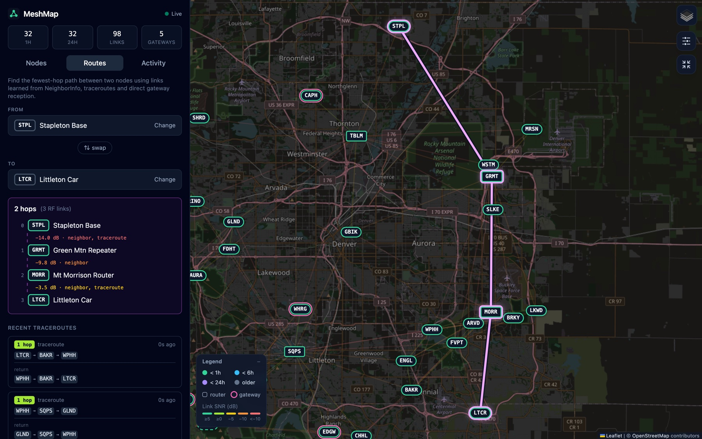
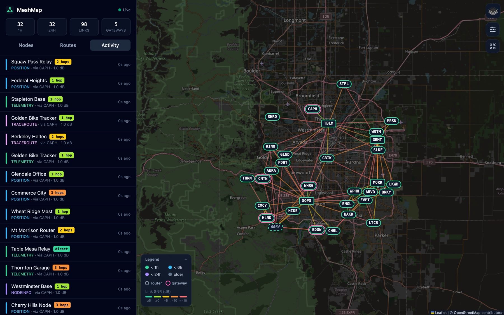
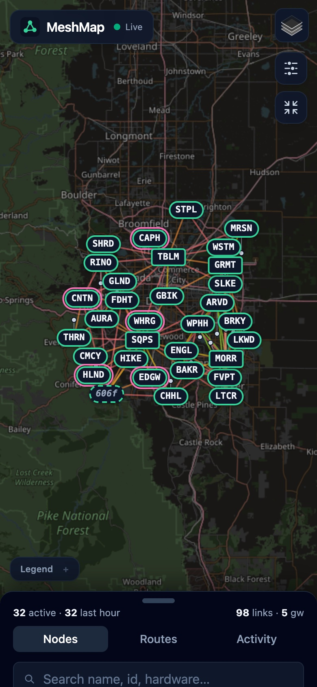
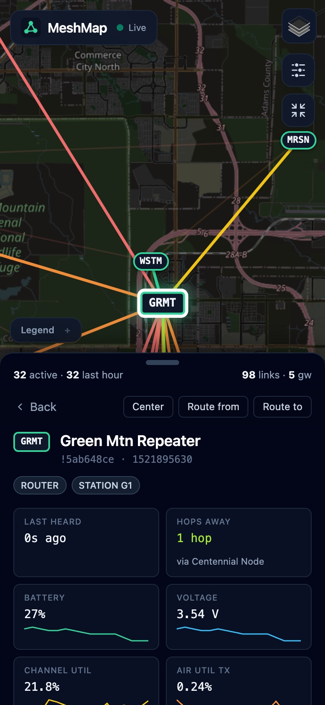

# MeshMap

A self-hosted, public-facing live map for a [Meshtastic](https://meshtastic.org) mesh. It shows each node's details and the RF links and hop counts between nodes.



```
Meshtastic nodes ──MQTT──▶ mosquitto :1883 ──▶ backend (Node 24, SQLite) ──/api + /ws──▶ frontend (nginx, React) :8080
```

| Service     | What it does |
|-------------|--------------|
| `mosquitto` | MQTT broker that nodes uplink to. The password file and ACL are generated from `.env` at startup. |
| `backend`   | Subscribes to `msh/#`, decrypts and decodes packets (protobuf and JSON), stores nodes, links, traceroutes and telemetry in SQLite, and serves a REST API with WebSocket live updates. |
| `frontend`  | React, Vite and Tailwind single-page app served by nginx. nginx also proxies `/api` and `/ws` to the backend. |

## Features

- **Map:** nodes are labelled with their short names. You can colour them by last heard, hops away or role. Routers are drawn as squares and MQTT gateways get a pink ring.
- **Links:** lines are coloured by SNR and dashed when only traceroutes have seen the link. Click a link for its SNR in each direction.
- **Node details:** hardware, role, firmware, battery, voltage, channel and air utilisation, uptime and environment sensors, with 24 h sparklines. Also shows position and track, RF neighbours with SNR both ways, how many nodes are within 1, 2 and 3 hops, traceroutes and recent packets.
- **Hops and routes:** pick two nodes to get the fewest-hop path over known links, drawn on the map with per-link SNR. Click any traceroute to draw its route.
- **Activity:** a live feed of packets.
- **Mobile and desktop:** desktop uses a sidebar. Phones get a full-screen map with a draggable bottom sheet.
- **Base layers:** dark, streets or satellite.

### Screenshots

| Node details | Fewest-hop route |
|---|---|
|  |  |
| **Activity feed** | **Mobile** |
|  |   |

<sub>Screenshots use simulated data: `npm run simulate -- --broker --demo` (see [Development](#development)).</sub>

### Where hop and link data comes from

| Source | How |
|---|---|
| **Hops away** | `hop_start − hop_limit` as seen by the gateway. The lowest value across all gateways that heard the packet is kept. |
| **NeighborInfo** links | Nodes with the NeighborInfo module enabled report their neighbours and the SNR they hear them at. |
| **Traceroute** links | Every traceroute reply adds its forward and return paths, with SNR per hop. |
| **Direct** links | A packet a gateway hears with 0 hops is a real RF link between the sender and the gateway. |

## Quick start

```bash
cp .env.example .env      # then edit the passwords
docker compose up -d --build
```

Open `http://<host>:8080`. For production, put it behind a TLS reverse proxy such as Caddy, Traefik or nginx. The proxy must forward WebSocket upgrades on `/ws`. Port `1883` must be reachable by your nodes or gateways.

### Configure your Meshtastic nodes

On each node that has internet access (WiFi, Ethernet, or a phone with "client proxy"):

1. **Module config → MQTT**
   - Enabled: on
   - Server address: `your.host:1883`
   - Username / password: `MQTT_NODE_USER` / `MQTT_NODE_PASSWORD` from `.env`
   - Root topic: `msh/<REGION>`, for example `msh/US`
   - Encryption enabled: on (recommended; the backend decrypts using `MESH_CHANNEL_KEYS`)
   - JSON enabled: optional (ESP32 only)
   - TLS: off, unless you terminate TLS in front of the broker
   - Map reporting: optional; it adds firmware version, region and modem preset
2. **Channels → primary channel → Uplink enabled:** on
3. Optional extra data:
   - Turn on the **NeighborInfo** module for neighbour links.
   - Run traceroutes from the app to discover paths, or let MeshMap schedule them (below).

**Automatic name requests (optional):** set `NAME_REQUESTS=true` and turn on **Downlink** for the gateway's primary channel. MeshMap then asks unnamed nodes for their name, the same way *Exchange user info* in the app does. Requests go out through the gateway that last heard the node, from MeshMap's own node ID (`nodeId` in `/api/stats`). They're rate limited to one every 30 s, `NAME_REQUEST_MAX_PER_HOUR` per hour, and once per node every `NAME_REQUEST_RETRY_HOURS`. The gateway must uplink with MQTT encryption on, because that's how MeshMap learns the channel's key and hash.

**Scheduled traceroutes (optional):** set `AUTO_TRACEROUTES=true` and turn on **Downlink** for the gateway's primary channel. MeshMap then sends a traceroute to one known node at a time, through the gateway that last heard it, and the reply adds the full path in both directions to the map. It skips nodes a gateway hears directly, since that link is already known, and prefers nodes it hasn't traced yet. Every traceroute floods the mesh, so the limits are deliberately low and all set in `.env`: at most `TRACEROUTE_MAX_PER_HOUR` per hour, `TRACEROUTE_MIN_INTERVAL_SECONDS` apart, each node once every `TRACEROUTE_RETRY_HOURS`, only nodes heard in the last `TRACEROUTE_HEARD_WITHIN_MINUTES`, and only nodes between `TRACEROUTE_MIN_HOPS_AWAY` (default 1) and `TRACEROUTE_MAX_HOPS_AWAY` hops out. MeshMap also never sends two packets of any kind within 30 s. It uses the same node ID as name requests (`MESHMAP_NODE_ID`). That node isn't on RF, so its legs are left off the map; the gateways it sent and received through are added to the path instead. Progress is in `/api/stats` under `autoTraceroutes`.

**Why some nodes show a hex ID instead of a name:** names come only from NODEINFO packets. Nodes broadcast those every ~3 hours and shortly after a reboot. Until one arrives, the map labels the node with the last 4 hex digits of its ID, drawn dashed and italic. To get the name sooner, use **Exchange user info** on that node in the Meshtastic app, or turn on Map Reporting on your gateways.

If your channel uses a custom PSK, add its base64 key to `MESH_CHANNEL_KEYS`, separated by commas. DMs encrypted with PKI can't be decrypted. Those packets still count toward hops and direct links.

### Keeping meshes separate (node isolation)

A gateway with **Downlink** on transmits whatever it receives on its MQTT topic. On a plain broker that includes other gateways' uplinks, so MQTT would join separate meshes into one. MeshMap's broker prevents this by default (`MQTT_NODE_ISOLATION=true`): the node account can publish anywhere under `msh/`, but can only *receive* topics that end in MeshMap's own node ID. Gateways still get MeshMap's name requests and traceroutes, but never each other's traffic, even on the same root topic.

Set `MESHMAP_NODE_ID` (for example `!7c10a186`) so the broker knows which topics to let through. Without it, the broker lets nodes receive nothing, so downlinked requests stop working, and the backend logs the ID to use. Set `MQTT_NODE_ISOLATION=false` to allow normal MQTT bridging between gateways.

Mosquitto's ACL can't stop the node account from *publishing* on MeshMap's topics. Real firmware only publishes under its own ID, so this only matters if someone with the node password does it deliberately.

### Feeding from another broker

To mirror a regional public broker as well, add a bridge file in the mosquitto container's `/mosquitto/config/conf.d/` directory, for example:

```
connection upstream
address mqtt.meshtastic.org:1883
remote_username meshdev
remote_password large4cats
topic msh/US/# in 0
```

## Configuration

All settings are in [.env.example](.env.example). The main ones:

| Variable | Default | |
|---|---|---|
| `MESH_CHANNEL_KEYS` | `AQ==` | Base64 PSKs to try when decrypting |
| `RETENTION_DAYS` | `7` | How long position, telemetry, packet and traceroute history is kept |
| `NODE_MAX_AGE_DAYS` | `30` | Nodes not heard for this long are removed |
| `LINK_MAX_AGE_HOURS` | `72` | Links not refreshed for this long are removed |
| `AUTO_TRACEROUTES` | `false` | Send rate-limited traceroutes on a schedule (see above) |
| `TRACEROUTE_MAX_PER_HOUR` | `4` | Hourly cap on scheduled traceroutes |
| `MIN_PRECISION_BITS` | `0` | Hides positions coarser than this |
| `MAP_CENTER` / `MAP_ZOOM` | | Initial view before nodes load |
| `TILE_URL` | | Your own dark tile server. The default is OpenStreetMap with a dark CSS filter. |

> **Tiles:** the default OpenStreetMap tiles are fine for light use. A busy public site should use its own tile provider, such as Stadia, MapTiler or a self-hosted server, via `TILE_URL`. See the [OSM tile usage policy](https://operations.osmfoundation.org/policies/tiles/).

## API

| Endpoint | |
|---|---|
| `GET /api/nodes` | All nodes |
| `GET /api/nodes/:id?hours=24` | One node. `:id` is `!a1b2c3d4` or a number. Returns links, traceroutes, position and telemetry history, and packets. |
| `GET /api/links` | Directed links: `to_num` heard `from_num` at `snr` |
| `GET /api/traceroutes?limit=100` | Recent traceroutes, with full paths that include both endpoints |
| `GET /api/packets?limit=100` | Recent receptions |
| `GET /api/stats` | Counts and ingest counters |
| `WS /ws` | `{type:"update", nodes, links, packets, traceroutes}`, batched once per second |

## Development

Requires Node 24 or later. The backend runs TypeScript directly through Node's type stripping, so there is no build step.

```bash
# backend + a simulated 30-node mesh (embedded broker, no Docker needed)
cd backend && npm install
npm run simulate -- --broker &      # fake encrypted Meshtastic traffic on :1883
npm run dev                         # API on :3000
npm test

# frontend (proxies /api and /ws to :3000)
cd frontend && npm install && npm run dev   # http://localhost:5173
```

Pointing the simulator at the Docker broker also works:

```bash
MQTT_USERNAME=meshdev MQTT_PASSWORD=... npm run simulate -- --url mqtt://localhost:1883
```

Simulator gateways answer downlinked traceroutes, so `AUTO_TRACEROUTES=true TRACEROUTE_MIN_INTERVAL_SECONDS=0` can be tested locally. Simulator options are `--demo` (realistic node names, used for the screenshots), `--nodes N`, `--interval ms`, `--stack N` (puts N extra nodes at the same spot, to test overlapping markers) and `--quiet N` (N nodes that never announce their name but answer name requests sent over downlink). Set `SIM_LAT` and `SIM_LON` to move the fake mesh.
